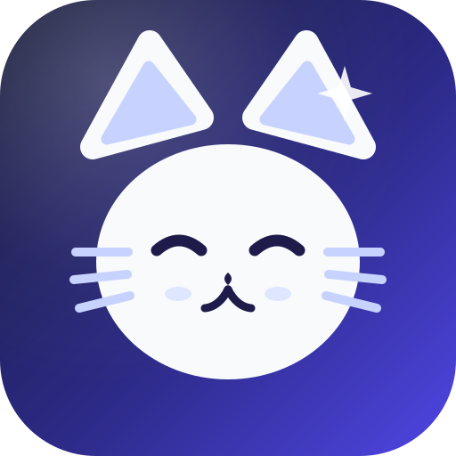
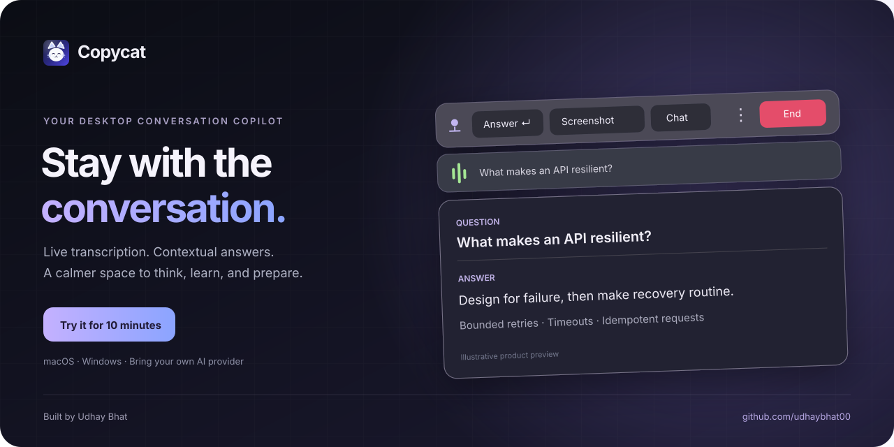
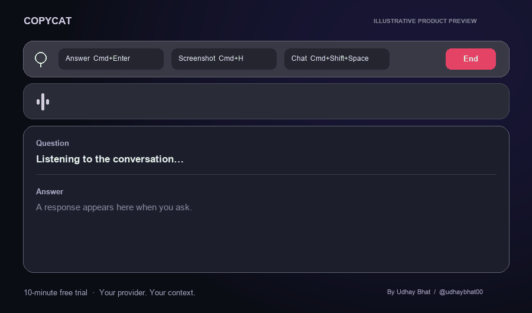
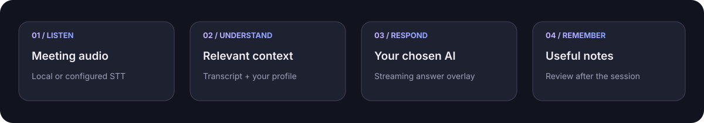

<div align="center">





# Copycat

### Your desktop conversation copilot.

Live transcription, relevant context, and a clear space for answers — built for macOS and Windows.

[](https://github.com/udhaybhat00/copycat/releases/latest)
[](https://github.com/udhaybhat00/copycat/releases/latest)
[](https://github.com/udhaybhat00)

**10-minute free trial · $20/month after the trial · BYOK**

[Website](https://copycat.isroot.in/) · [Setup guides](https://copycat.isroot.in/guides/) · [Download](https://github.com/udhaybhat00/copycat/releases/latest) · [Pricing & activation](#-pricing--activation) · [Privacy](#-privacy-by-configuration) · [Support](#-support)

</div>

> This is Copycat’s official **download and documentation repository**. It contains product assets, release notes, and links to installers. **Application source code is not published here.**

## A little less switching. A little more thinking.

Copycat keeps the conversation, the question, and the response together in a compact desktop overlay. Use it to rehearse an interview, learn from a technical discussion, prepare a thoughtful response, or support a meeting where participants have agreed to recording and assistance.



<sub>Original illustrative product preview. The example conversation is fictional; it is not a performance benchmark or a recording of a customer.</sub>

## ✨ A focused workspace

| During the conversation | Around the conversation |
| --- | --- |
| **Live transcription** of meeting audio, with a meter driven by captured audio levels. | **Resume and profile context** to make preparation relevant to your experience. |
| **Question → answer layout** with streamed responses, history navigation, and copy controls. | **Session context** that brings relevant earlier discussion into the current response. |
| **Auto Answer** can respond when a question is complete; manual Answer remains available. | **Meeting notes** to review the conversation and its useful takeaways. |
| **Resizable translucent overlay** with keyboard shortcuts and appearance preferences. | **Provider choice** for transcription and AI answers, including supported local models. |

AI response time and recognition quality depend on your hardware, audio quality, selected models, and provider. Review generated answers before relying on them.

## 🎙️ From sound to something useful



```text
Your session
├── Meeting audio
│   ├── Real audio-level meter
│   └── Local or configured transcription provider
├── Relevant context
│   ├── Current conversation
│   ├── Earlier discussion in the same session
│   └── Resume / profile, where relevant
├── Your chosen AI provider
│   └── Streamed response in the overlay
└── Review
    ├── Copy useful answers
    └── Revisit session notes
```

Copycat listens to **meeting/system audio by default**, rather than opening your physical microphone. Audio permissions and capture capabilities vary by operating system. Review Settings before your session.

## 📥 Download & start

Open the [latest release](https://github.com/udhaybhat00/copycat/releases/latest) and choose the build matching your device:

| Device | Choose |
| --- | --- |
| 🍎 **Mac with Apple Silicon** | [⬇️ Download for Apple Silicon](https://github.com/udhaybhat00/copycat/releases/download/v1.1.0/Copycat-1.1.0-arm64.dmg) |
| 💻 **Mac with an Intel processor** | [⬇️ Download for Intel Mac](https://github.com/udhaybhat00/copycat/releases/download/v1.1.0/Copycat-1.1.0.dmg) |
| 🪟 **Windows 10/11, x64** | [⬇️ Download Windows installer](https://github.com/udhaybhat00/copycat/releases/download/v1.1.0/Copycat-Setup-1.1.0.exe) · [Portable](https://github.com/udhaybhat00/copycat/releases/download/v1.1.0/Copycat.1.1.0.exe) |

Available files, compatibility requirements, signing status, and known limitations are listed in each release. Download directly from this repository’s releases; do not install repackaged copies from other sites.

1. Install the appropriate build and launch Copycat.
2. Configure your transcription model and AI provider in **Settings**.
3. Add your resume or profile if you want relevant preparation context.
4. Start a session and use your **10-minute trial** to explore the workflow.
5. Set your preferred shortcuts, transparency, cursor behavior, and Auto Answer in Settings.

**BYOK means bring your own key.** The Copycat subscription provides app access. Charges from an external AI or transcription provider are separate. A supported local model can avoid that provider’s per-request charges, subject to hardware requirements.

## 🔑 Pricing & activation

### 10 minutes to try it. $20 per month to keep using it.

- **Trial:** 10 minutes of free session experience, before the activation screen appears.
- **Subscription:** **US$20/month** for access on your activated device.
- **India:** the price is shown in **INR using the current USD–INR reference rate**. The displayed conversion is an estimate; your payment arrangement determines the final billed amount and any fees.
- **Device activation:** activate the device once with your issued license key. Access continues while the subscription is valid. This is **monthly access, not a lifetime purchase**.
- **Purchase request:** the app’s **Activate** button opens your default mail app with a professional request and your device ID already filled in. You review and send it yourself.
- **Contact:** [udhaybhat00@gmail.com](mailto:udhaybhat00@gmail.com?subject=Copycat%20monthly%20subscription%20request).

Already have a key? Use the activation field in the app. For a renewal, device change, or activation problem, email the creator with your device ID and a description of the issue. Do not post your license key publicly.

## 🔒 Privacy by configuration

Copycat is designed around local desktop work, with clear provider choices:

- **Local transcription:** when you select a supported local speech model, recognition runs on your device.
- **Cloud transcription:** when you select a cloud speech provider, audio is sent to that provider under its terms.
- **AI answers:** prompts and the relevant context sent to a hosted AI model leave your device. Choose a supported local model if you want to keep that processing local.
- **License service:** activation uses a device identifier and license status. It does not need your meeting audio, transcript, or AI-provider keys.
- **Your controls:** review capture, transcript retention, model, and provider settings. Get consent where needed before recording or transcribing conversations.

Copycat cannot guarantee invisibility to operating-system privacy indicators, screen-recording tools, or other software.

## 👨‍💻 Built by Udhay Bhat

Created and maintained by **[Udhay Bhat · @udhaybhat00](https://github.com/udhaybhat00)**.

[](https://github.com/udhaybhat00)
[](https://github.com/udhaybhat00/copycat)

If Copycat helps your preparation or meetings, a star makes the project easier to discover. Thoughtful bug reports help improve it.

## 💬 Support

- **Bugs and suggestions:** [open an issue](https://github.com/udhaybhat00/copycat/issues).
- **Licensing and purchases:** [udhaybhat00@gmail.com](mailto:udhaybhat00@gmail.com).
- **Downloads and release notes:** [Copycat releases](https://github.com/udhaybhat00/copycat/releases).

When reporting a bug, include your app version, operating system, chip architecture, provider/model names, and steps to reproduce. Redact API keys, license keys, device IDs, and private conversation content from public reports.

---

<div align="center"><sub>Copycat · macOS & Windows · Made by <a href="https://github.com/udhaybhat00">Udhay Bhat</a><br>Proprietary application. This public repository distributes downloads and documentation only.</sub></div>
